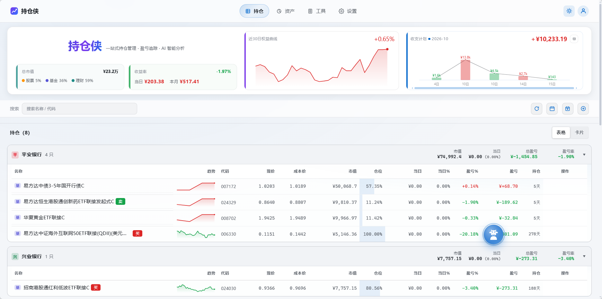

# 持仓侠 / MoneyComes


> 「牛来：妈妈，我的账户又绿了，牛还来吗？」
>   
> 「妈妈：牛会回来的。」
>
> 在牛回来之前，先把家底交给 **持仓侠（MoneyComes）**：股票、基金、理财、现金、负债、收支一个账本全收；盈亏自动算、历史天天记；房贷车贷到点自动提醒你别逾期。牛来牛去，心里有数。

> 自托管的多用户个人投资持仓看板，统一管理 **A 股 / 美股 / 港股 / 基金** 持仓（含理财）/ 现金 / 负债 / 流水 / 收支等。自动刷新行情（不含理财）、计算盈亏、记录历史，提供盈亏日历、技术分析/**基金关联股票代码**与 AI 助手。桌面与移动端自适应。
>
> 配套 **PySide6 手机采集客户端（pfclient）**：把手机券商 / 基金 App 的持仓与理财页面通过 **USB 自动截图 + 本地 OCR** 采集并写回后端，自动完成持仓导入与净值更新，告别手工抄录。当前主力支持 **iOS**，Android 通道规划中。

## 📖 目录

- [🌐 在线 Demo](#-在线-demo)
- [✨ 功能一览](#-功能一览)
- [界面预览](#界面预览)
- [MCP 服务（连接 hermes 等 AI 客户端）](#-mcp-服务连接-hermes-等-ai-客户端)
- [📱 手机采集客户端（pfclient）](#手机采集客户端pfclient)
- [快速开始](#快速开始)
- [贡献与支持](#贡献与支持)
- [许可](#许可)

## 🌐 在线 Demo

**<https://www.mrchenyifei.icu:19999>** · 预置了一套模拟数据（8 只持仓 / 多币种账户 / 理财 / 负债 / 近 30 日盈亏历史），行情定时自动刷新。

## ✨ 功能一览

**持仓与行情**

- 多市场持仓（A 股 / 美股 / 港股 / 场内场外基金）按来源分组统一管理；
- 理财支持批量更新持仓、申赎流水与快照对比（顶部「更新理财持仓」刷新快照）。
- 行情由每日定时快照自动刷新；首页展示当日 / 总盈亏、盈亏率、持有天数与近 20 日走势。

**盈亏分析**

- 盈亏日历按日热力着色，支持年 / 月跳转与单日持仓级明细。

**技术分析**

- 每只持仓提供 K 线 + MA / MACD / RSI / KDJ / BOLL 全指标。
- 自动信号评级（看多 / 看空）与逐日回测胜率、期望收益，结果按日缓存。
- 场外基金 / QDII 可关联场内 ETF 代码，直接复用该 ETF 的 K 线与信号。

**资产**

- 现金账户支持多币种、每来源每币种默认子账户与账户间转账。
- 收支计划支持一次性 / 循环模式，逐月还款构成可视化。

**🛠 工具箱**

- 汇率计算：CNY / HKD / USD 实时汇率互换算。
- 贷款计算：等额本息 / 等额本金，逐月还款与本金利息构成可视化。

**MCP 服务**

- 内建零依赖 MCP 服务端（stdio / HTTP(SSE)），AI 客户端可查询账本并按名称/代码定位实体记录流水。
- 提供 `record_transaction` 写入与 `list_amount_modifiable` / `list_accounts` / `list_cash_accounts` / `list_holdings` / `list_wealth` 查询工具。
- MCP 写入的流水在表格中打高亮 **MCP** 标签。

**AI 助手**

- 一键生成全资产 / 权益类总结，支持自定义提示词与多模型配置。
- 可每日收盘后自动生成，并随净值推送发送。
- 结果按 Markdown 渲染（支持表格），渲染前做 XSS 转义。

**手机采集客户端（pfclient）**

- 配套 PySide6 桌面端，连接手机后把券商 / 基金 App 的**持仓页**与**理财页**经 **USB 自动截图 + 本地 OCR** 采集并写回后端。
- 自动流水线：**自动截图 → 持仓导入 → 净值更新**，覆盖 Windows / macOS；iOS 17+ 走 USB DVT 原生截图（App 无感知），长列表走 CoreDevice 自动长屏。
- 当前主力支持 **iOS**（含开发者模式解锁、环境自愈）；**Android 通道规划中**（Scrcpy / adb）。

**其他**

- 通知支持钉钉（加签）与邮件（TLS），可按策略推送当日盈亏明细。
- 多用户隔离（`X-User-Id`，上限 5 人、每类资产每用户 200 条），清空 / 删除需输入确认短语。
- 暗黑 / 亮色双主题与可自定义主题色。

## 界面预览

|                                            预览图                                           |
| :--------------------------------------------------------------------------------------: |
|   **主页（亮色）**<br />   |
|          **资产**<br />         |
|    **盈亏日历**<br />    |
| **技术分析（QQQ）**<br /> |
|   **AI 助手**<br />   |

## MCP 服务（连接 hermes 等 AI 客户端）

内建**零依赖 MCP 服务端**（stdio / HTTP(SSE)，默认端口 `9988`）：hermes 等 AI 客户端可先查询账本（账户 / 子账户 / 持仓 / 理财），再按名称/代码定位实体记录流水（加仓 / 减仓 / 分红、现金存取、理财申赎）。

- **配置**：**设置 → AI → MCP 参数** 页一键开关、选传输方式、填地址与令牌，并可复制 hermes 客户端配置；HTTP 模式保存后重启 MCP 服务生效（stdio 用 `portfolio mcp` 启动）。
- **启用（环境变量）**：`MCP_ENABLED=true` / `MCP_TRANSPORT=http` / `MCP_HTTP_ADDR=:9988`；不设则默认关闭、零开销。
- **定位实体**：AI 按**名称 / 证券代码**（大小写不敏感、包含匹配）定位目标；命中多个时返回候选列表供选择。表单中的「备注」仅作说明，不参与定位。
- **工具**：写 `record_transaction`；读 `list_amount_modifiable` / `list_accounts` / `list_cash_accounts` / `list_holdings` / `list_wealth`。均可选 `username` / `user_id` 指定归属用户。
- **流水来源**：MCP 写入的流水 `source='mcp'`、`type` 以 `mcp_` 开头，前端流水表打高亮 **MCP** 标签。

完整参数、返回结构与调用示例见 [`docs/mcp-api.md`](docs/mcp-api.md)。

## 📱 手机采集客户端（pfclient）

为摆脱手工抄录，项目附带一个 PySide6 桌面客户端（`client/`），把手机券商 / 基金 App 的**持仓**与**理财**页面通过**自动截图 + 本地 OCR** 采集并写入后端，覆盖 Windows / macOS。

### 自动采集流水线：截图 → 持仓导入 → 净值更新

```
手机 App 持仓 / 理财页 ──(USB DVT 原生截图 / CoreDevice 自动长屏)──▶ 原生 PNG
        │
        ▼
本地 RapidOCR 识别（表格结构解析 + 千分位消歧）
        │
        ▼
核对窗（列映射 + 人工修正错别字）
        │
        ├─▶ 持仓导入   POST /api/holdings（新建）｜ PUT /api/holdings/:id（更新现价）
        ├─▶ 净值更新   POST /api/asset/wealth/snapshots（理财快照，刷新产品净值）
        └─▶ 现金调整   POST /api/asset/cash/adjust
```

- **自动化截图**：iOS 17+ 主力走 `usb` 源（pymobiledevice3 `developer dvt screenshot` 原生 PNG，App 完全无感知）；长列表走 **CoreDevice 自动长屏**（注入真实触摸自动滚动 + 原生截图 + NCC 纵向拼接），无需逐屏手动。投屏镜像（uxplay）为备选方案，因银行 App 会检测投屏拦截，主力采集不用它。
- **持仓导入**：`flow/guide.py` 引导式判页状态机，OCR 命中持仓列表即自动触发截图，核对窗确认后写库。
- **净值更新**：持仓导入时把识别到的现价 / 市值回写 `PUT /api/holdings/:id`；理财产品走 `POST /api/asset/wealth/snapshots` 写入当日净值快照，后端据此刷新盈亏，无需手工录入。

> 通道原理、前置条件（Apple Devices 驱动 / 开发者模式解锁）、环境自愈等细节见 [`client/README.md`](client/README.md)。

### TodoList（当前进度）

> **当前正在实现 iOS 相关功能；Android 暂未实现**（计划 Scrcpy / `adb shell input tap` + `exec-out screencap`）。

- [x] USB DVT 原生截图通道（iOS 17+ 主力，App 无感知）
- [x] CoreDevice 自动长屏（滚动 + 截图 + 拼接，验证脚本已通）
- [x] 解锁开发者模式（AMFI reveal，GUI 按钮 + 脚本）
- [x] 持仓导入链路（引导 + OCR 判页 + 核对窗 + 写库）
- [x] 净值更新接口串联（holdings 现价回写 / wealth 快照）
- [ ] OCR 提速（表格区域裁剪、长边缩到 ~1600、ONNXRuntime GPU / TensorRT）
- [ ] 多屏持仓列表与自动长屏融合（现多屏手动逐屏，自动长屏独立）
- [ ] 流水（flows）核对后自动写库（现仅核对，避免重复记账）
- [ ] 采集安全收尾自动化（撤销配对 + 删除描述文件）
- [ ] **Android 采集通道**（Scrcpy / adb）
- [ ] 打包（PyInstaller Win / py2app mac）

## 快速开始

### 云端镜像（推荐，无需克隆源码）

镜像由 GitHub Actions 自动构建（`linux/amd64` + `linux/arm64`），推送到 GHCR，每个 main 提交更新 `latest`、每个 `v*` 标签发布版本号：

```bash
docker run -d --name portfolio -p 9989:9989 -p 9988:9988 \
  -v portfolio-data:/data \
  -e TZ=Asia/Shanghai \
  -e MCP_ENABLED=true \
  -e MCP_TRANSPORT=http \
  -e MCP_HTTP_ADDR=:9988 \
  ghcr.io/w1570187062/my-portfolio-hub:latest

# 或用 docker compose（compose.yml 里 image 填 ghcr.io/w1570187062/my-portfolio-hub:latest）
docker compose up -d
```

- `-p 9989:9989`：Web 主端口（前端页面与 API）。
- `-p 9988:9988`：MCP 服务端口（HTTP/SSE 传输，供 hermes 等 AI 客户端远程连接）；若不需要 AI 客户端接入可省略该映射，并将 `MCP_ENABLED` 留空（默认关闭）。
- `MCP_ENABLED=true` / `MCP_TRANSPORT=http` / `MCP_HTTP_ADDR=:9988`：开启并配置内建 MCP 服务端（详见下文「MCP 服务」）。

访问 <http://localhost:9989> 即可；升级只需 `docker pull` 后重建容器。

### 从源码构建

> 前端 `web/dist` 不入库（见 `.gitignore`），构建前必须先在本地编译前端，否则 `Dockerfile` 的 `fe` 阶段会因缺少 `web/dist` 直接报错。

```bash
# 1) 编译前端（生成 web/dist/，main.go 通过 //go:embed 内嵌）
npm --prefix web install   # 仅首次或依赖变动时需要
npm --prefix web run build

# 2) 构建并启动（--no-cache 确保重新嵌入最新前端）
docker compose build --no-cache && docker compose up -d --force-recreate
```

数据持久化在 `data/portfolio.db`，挂载为 volume。

### 本地运行

```bash
# 前端仍需先编译（见上方「从源码构建」第 1 步），否则 go:embed 找不到 web/dist
npm --prefix web install && npm --prefix web run build
go mod tidy
go build -o portfolio .      # 产物 ./portfolio
./portfolio                  # 监听 :9989，可用 PORT 环境变量覆盖
# 开发期也可直接：go run .
```

数据落在 `./data/portfolio.db`（compose 已挂 volume）。停止：`docker compose down`（保留数据）；`docker compose down -v` 连数据卷一并删除，慎用。

## 贡献与支持

- 如果这个项目对你有帮助，欢迎点右上角 ⭐ **Star** 支持一下，这是持续维护的最大动力。
- Bug / 建议 / 新功能：欢迎提 [Issue](https://github.com/w1570187062/my-portfolio-hub/issues) 或 Pull Request（fork → 新建分支 → 提交 → 发起 PR）。
- 想先看看效果：可直接访问[在线 Demo](https://www.mrchenyifei.icu:19999)。

## 许可

本项目基于 **MIT License** 发布，详见 [LICENSE](LICENSE)。自托管个人项目，请遵守所在司法辖区的金融数据法规。
