# 持仓侠 / Portfolio Tracker

自托管的个人投资账本（支持多账本隔离）：统一管理 **A 股 / 美股 / 港股 / 基金（含理财）/ 现金 / 负债 / 收支**，行情自动刷新、盈亏自动计算与历史归档，并提供盈亏日历、技术分析、止盈止损提醒与 AI 助手。桌面与移动端自适应，支持暗黑 / 亮色主题与自定义主题色。

> 在线 Demo：<https://www.mrchenyifei.icu:19999>（预置模拟数据，行情定时自动刷新）
> 品牌「持仓侠」，图标折线渐变紫；涨红跌绿（国内惯例）。

## 界面预览

| 预览 | 预览 |
| :---: | :---: |
| **首页 Dashboard**<br />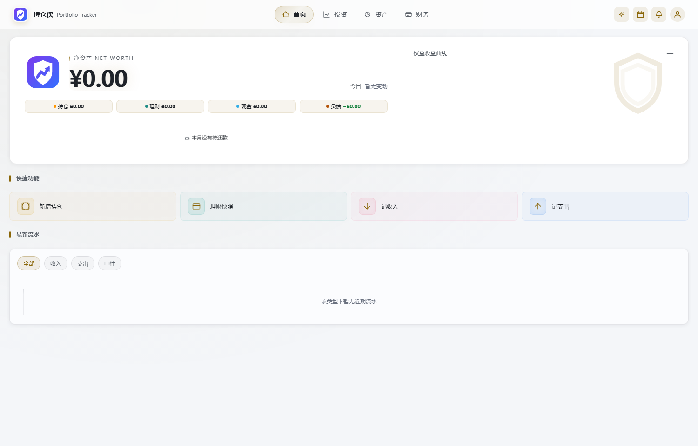 | **投资 · 持仓**<br />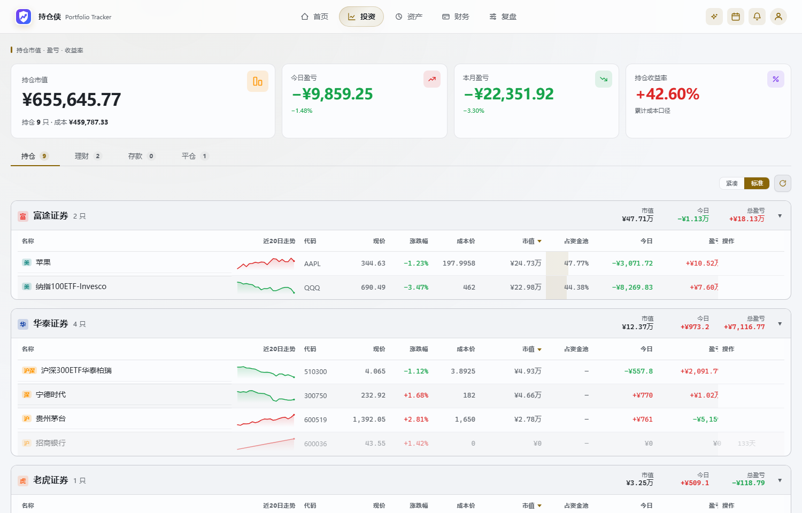 |
| **资产全景**<br />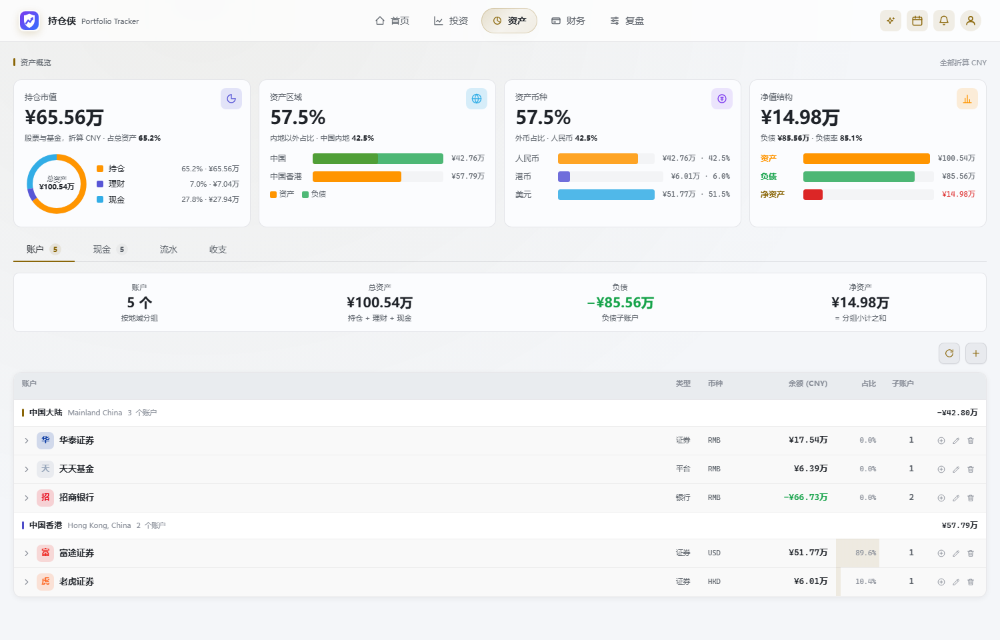 | **财务分析**<br />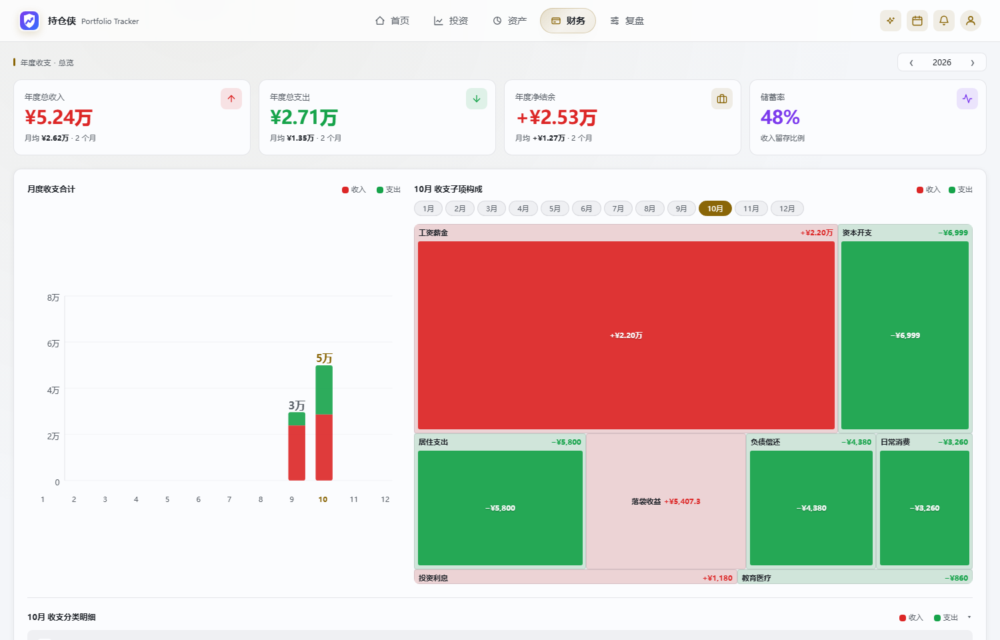 |
| **复盘 · 收益率诊断**<br />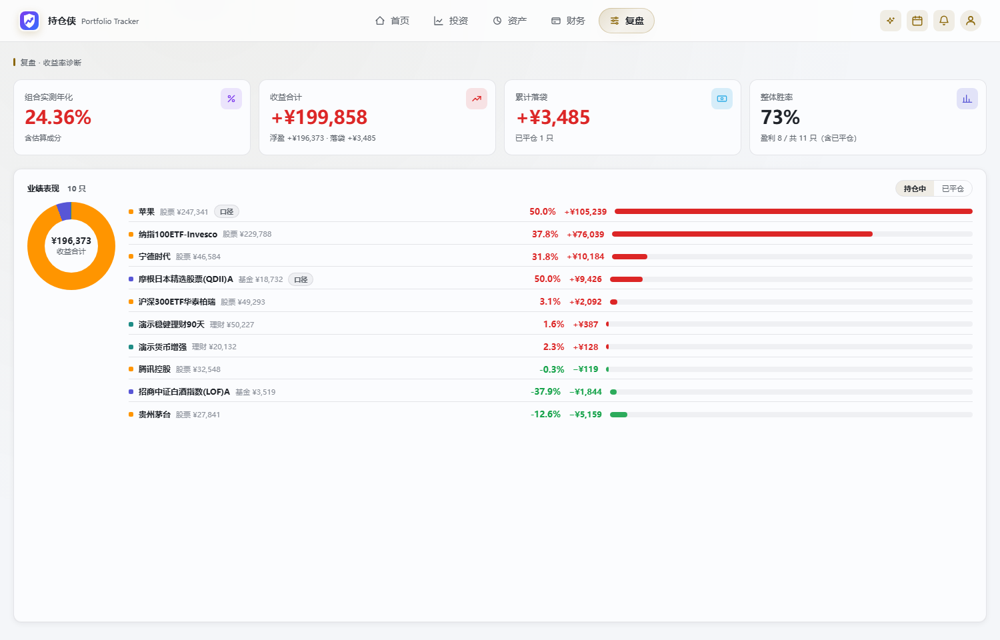 | **盈亏日历**<br />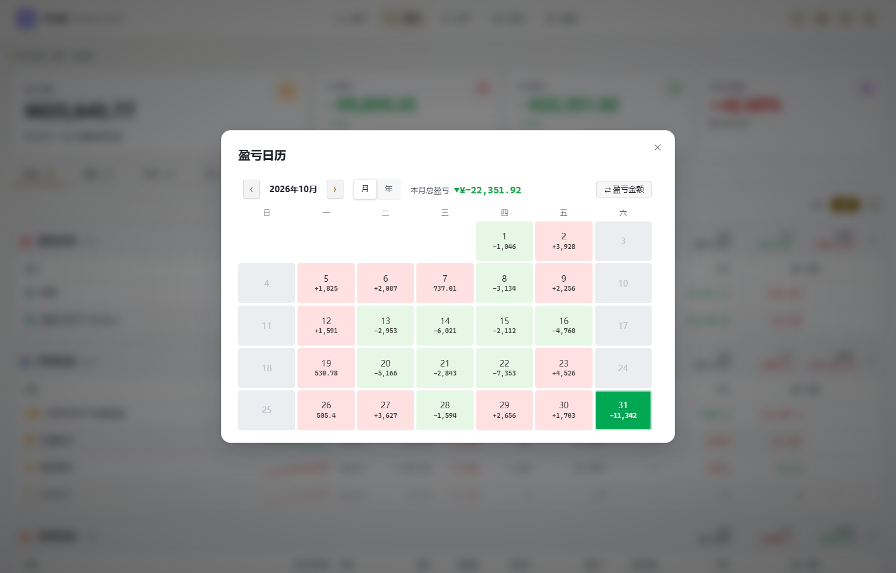 |
| **技术分析**<br />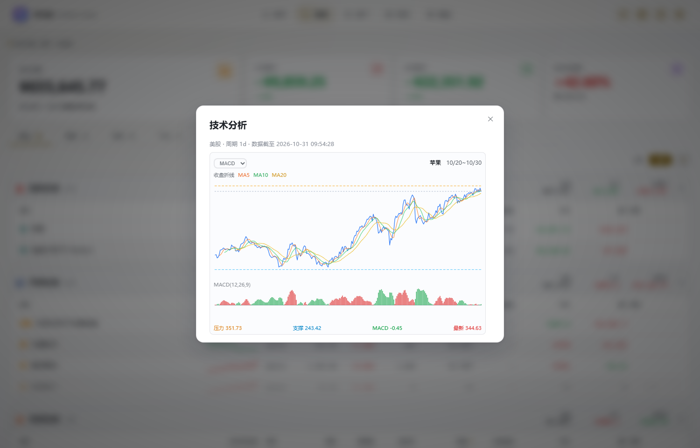 | **AI 助手**<br />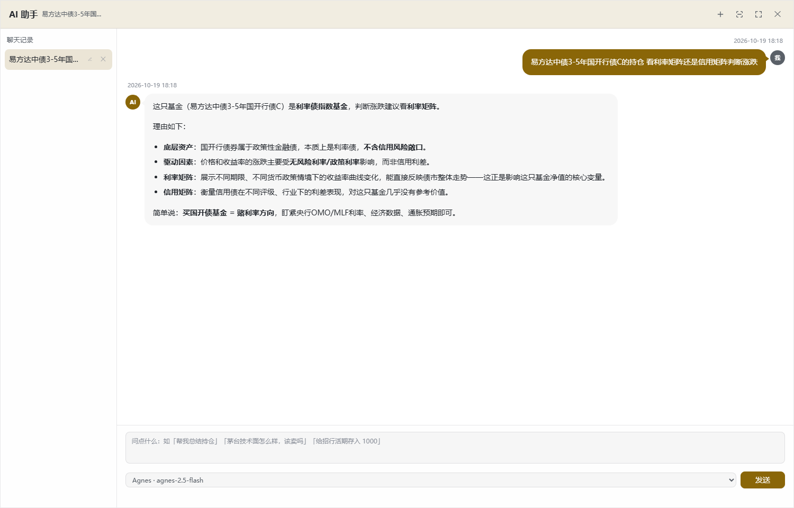 |
| **止盈止损 · 通知中心**<br />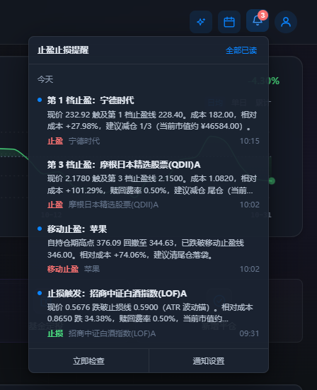 | **提醒详情**<br />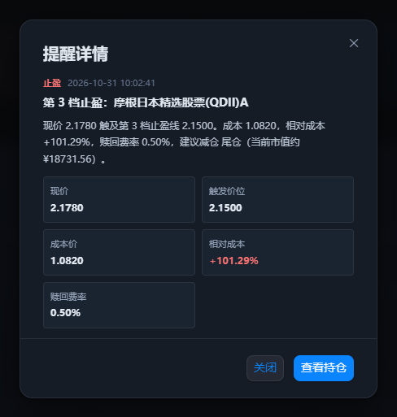 |

## 功能一览

五大视图（顶部导航）：**首页 · 投资 · 资产 · 财务 · 复盘**；系统设置收在右上角个人菜单里（同头像下拉）。

**首页 Dashboard** — 净资产 Hero + 资产分布 + 快捷功能 + 最新流水，一眼看全局。

**投资（持仓 / 理财 / 存款 / 平仓）**
- 持仓：A 股 / 美股 / 港股 / 基金按来源分组，展示当日盈亏、持仓收益率、持有天数与近 30 日走势；
- 加仓 / 减仓 / 现金分红（含红利再投）/ 交易回退（LIFO，原记录留痕）；清仓后可重开。
- 理财：净值快照对比、申赎流水、赎回 / 减仓 / 清仓；存款（定期 / 大额存单）到期确认后落账利息。
- 平仓：持仓（份额归零）+ 理财（归档）的落袋收益总览。
- 定投计划：基金 / 股票标的均可挂计划（周期 / 金额 / 限购 / 暂停）+ 期次（逐期确认、可改可撤、禁删已执行）；每期费用直接填固定金额（基金=申购费、A 股=佣金 5 元起步 + 过户费、美股多为零佣金），不做按费率的换算——改每期金额不会偷偷重算费用。

**资产全景** — 子视图：账户（来源 / 多币种现金子账户 / 负债，账户 ⇄ 负债可转换、子账户间转账）/ 流水 / 收支（一次性 / 循环计划，逐月还款可视化，待还款提前一天提醒）。

**财务** — 年度收支分析：4 张 KPI 卡 + 年度收支热力图 + 月度分类明细（语义分类：收入 / 支出 / 转账）。

**复盘（收益率诊断）** — 逐标的实测年化与收益归因，数字全部由后端 `GET /api/review` 算好，前端只负责呈现（避免前后端各算一套）：
- 4 张 KPI：组合实测年化（含估算成分）/ 收益合计（浮盈 + 落袋）/ 累计落袋（已平仓 N 只）/ 持仓胜率（盈利 N / 共 N 只）。
- 业绩表现卡：左侧收益占比圆环 + 右侧单一榜单（年化 · 收益额 · 条形长度同比例），按收益总额排序；可切「持仓中 / 已平仓」，默认 10 条、可展开全部。
- 页面已不展示「目标 vs 实际」权重偏离表。那套再平衡口径（股票 / 基金 / 理财 / 现金四大类，目标权重 + 年化假设 + 偏离阈值）仍保留在 `GET /api/rebalance`，由 AI 助手（`get_rebalance` 工具）消费。
- **日常开销不计入**：现金子账户可勾「日常开销账户」（资产页子账户行打「日常」徽标），这类钱既不算现金类市值、也不进总市值分母 —— 生活费不是可配置资产，混进去会让 AI 的调仓建议把下个月开销也转出去。


**盈亏日历 & 技术分析**
- 盈亏日历：按日热力着色，年 / 月跳转，单日持仓级明细（含理财收益）。
- 技术分析：每只持仓 K 线 + MA / MACD / RSI / KDJ / BOLL，自动信号评级（看多 / 看空），结果按日缓存；场外基金 / QDII 可关联场内 ETF 代码复用其 K 线与信号。

**止盈止损提醒** — 每只持仓在「高级选项」里单独设方案（保守 / 均衡 / 激进 / 自定义，或直接关闭），价位由收盘价与技术波动算出，不用手工盯盘：
- **止损取更宽的那条**：ATR 波动锚 vs 结构锚（MA60 / 近 20 日低点 ×0.99）谁更宽用谁，再用「最大容忍亏损」兜底 —— 三者取紧会让止损贴在现价上，一根阴线就被扫出局。
- **止盈分三档递减**（1/3 → 1/3 → 尾仓），第二、三档同时参考 60 / 120 日高点；浮盈过阈值后止损自动抬到成本之上（保本），再叠加**移动止盈**（自持仓期高点回撤 N%，且只在仍盈利时接管）。
- **心理价位**只提醒、不参与计算，可写自己的理由；`mode=off` 即完全不止盈不止损。
- **赎回费闸门**：只有场外基金（C 类）才存在时间成本，阶梯可编辑（7 天 / 7–30 天 / 30 天常见档）或直接填实际费率；股票 / 场内 ETF 不显示该项，提醒正文也不会出现「赎回费率」。
- 触发后进站内**通知中心**（右上角铃铛，红点显示未读），点条目看详情：触发价、成本、相对成本、当前市值，基金多一格赎回费率；钉钉 / 邮件可单独开关。
- **同一档位只提醒一次**（`dedupe_key` 唯一索引兜底，并发扫描也不会重复），可改为每日一次；首次启用只落库不回灌 —— 点一次「全部启用」，历史旧账不会一次性推到手机。

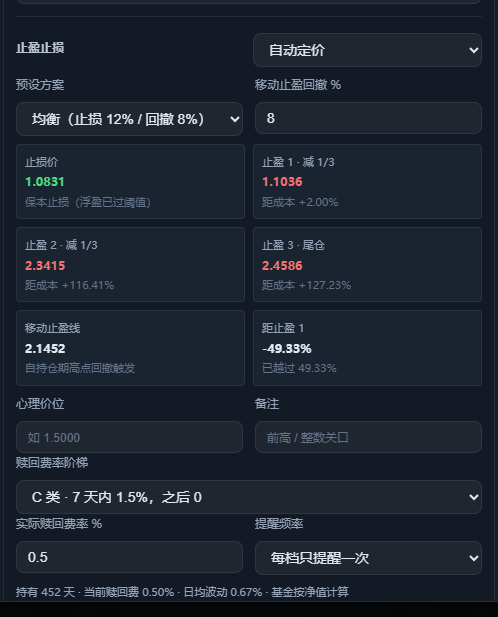

**现金 & 负债** — 多币种（CNY / HKD / USD）现金子账户，出资 / 回款自动联动记账；负债清偿与待还款提醒。

**AI 助手** — 右下角悬浮聊天面板（多会话 + 工具调用式对话），可查账本、记流水、做技术分析、看资产再平衡偏离，支持一键生成全资产 / 权益类总结，可每日收盘后自动推送；Markdown 渲染并做 XSS 转义。

**截图识别** — AI 助手面板内置（头部图标入口 + 输入框图片按钮）：截图 / 粘贴 / 拖拽进来后由浏览器本地 OCR（tesseract.js，中英混排）识别，图片不上传服务器、不经过大模型；识别结果可编辑并自动提取金额 / 余额 / 净值 / 日期，一键带参打开「更新流水 / 更新理财 / 更新账户余额」完成记账。

**MCP 服务** — 内建零依赖 MCP 服务端（stdio / HTTP），供 hermes 等 AI 客户端查询账本并按名称 / 代码定位实体记录流水（写 `record_transaction`；读 `list_*` 系列 + `get_rebalance` 再平衡快照）。工具实现由 Web 层注入，AI 答复与页面数字同源。默认关闭、零开销。

**多账本 & 设备授权** — 账本数据隔离（上限 5 本、每类资产每账本 200 条），清空 / 删除需输入确认短语。设备用一次性配对码接入，**首台设备自动成为主设备**：加设备 / 吊销其他设备 / 改操作 PIN / 删清账本 / 导入只归它，且都要再输一次操作 PIN；主设备身份可在设备页输 PIN 转移给别的设备，主设备退出登录时自动交接给最早接入的那台。操作 PIN 存哈希无法找回，认领时会生成一份一次性**恢复码**用于重置。暗黑 / 亮色双主题，主题色可自定义。

**手机采集客户端（pfclient）** — 配套 PySide6 桌面端（`client/`），把券商 / 基金 App 的持仓与理财页经 **USB 自动截图 + 本地 OCR** 采集并写回后端，覆盖 Windows / macOS；当前主力支持 iOS（USB DVT 原生截图 + CoreDevice 自动长屏），Android 通道规划中。

## 快速开始

镜像由 GitHub Actions 自动构建（`linux/amd64` + `linux/arm64`，推 GHCR，`latest` 随 main 更新）：

```bash
docker run -d --name portfolio -p 9989:9989 -p 9988:9988 \
  -v portfolio-data:/data \
  -e TZ=Asia/Shanghai \
  -e MCP_ENABLED=true -e MCP_TRANSPORT=http -e MCP_HTTP_ADDR=:9988 \
  ghcr.io/w1570187062/my-portfolio-hub:latest
# 或 docker compose up -d
```

- `9989`：Web 主端口；`9988`：MCP 端口（不需要 AI 客户端接入可省略，并将 `MCP_ENABLED` 留空）。
- 数据持久化于 `/data/portfolio.db`（挂载 volume）。访问 <http://localhost:9989>；升级只需 `docker pull` 后重建容器。

**从源码构建**（前端 `web/dist` 不入库，构建前必须先编译，否则 `Dockerfile` 因缺 `web/dist` 报错）：

```bash
npm --prefix web install && npm --prefix web run build   # 生成 web/dist（go:embed 内嵌）
docker compose build --no-cache && docker compose up -d --force-recreate
```

本地运行：`npm --prefix web run build && go build -o portfolio . && ./portfolio`（监听 `:9989`，可用 `PORT` 覆盖）。

## 技术栈

- 后端：Go + Gin + SQLite（`go:embed` 内嵌前端）；定时快照（美股 07:00 / A 股 15:15 / 基金 21:00）与每日 00:00 归零结算；快照落地后顺带跑一遍止盈止损扫描，另有独立定时任务兜底。
- 行情：A 股 / 港股 / 美股经腾讯行情源；基金经净值接口；PE/PB：A 股=东方财富，美 / 港=腾讯；汇率 CNY/HKD/USD 实时缓存。
- 前端：原生 HTML/CSS/JS（PWA，离线可用）。

## 许可

基于 **MIT License** 发布（详见 [LICENSE](LICENSE)）。自托管个人项目，请遵守所在司法辖区的金融数据法规。
