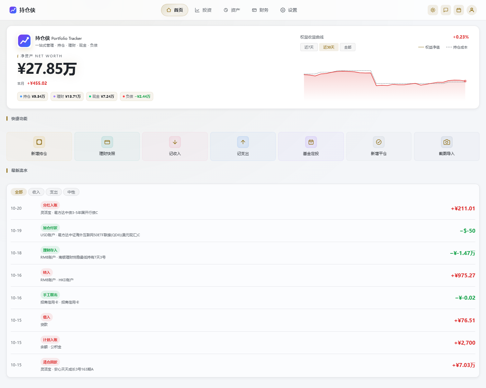
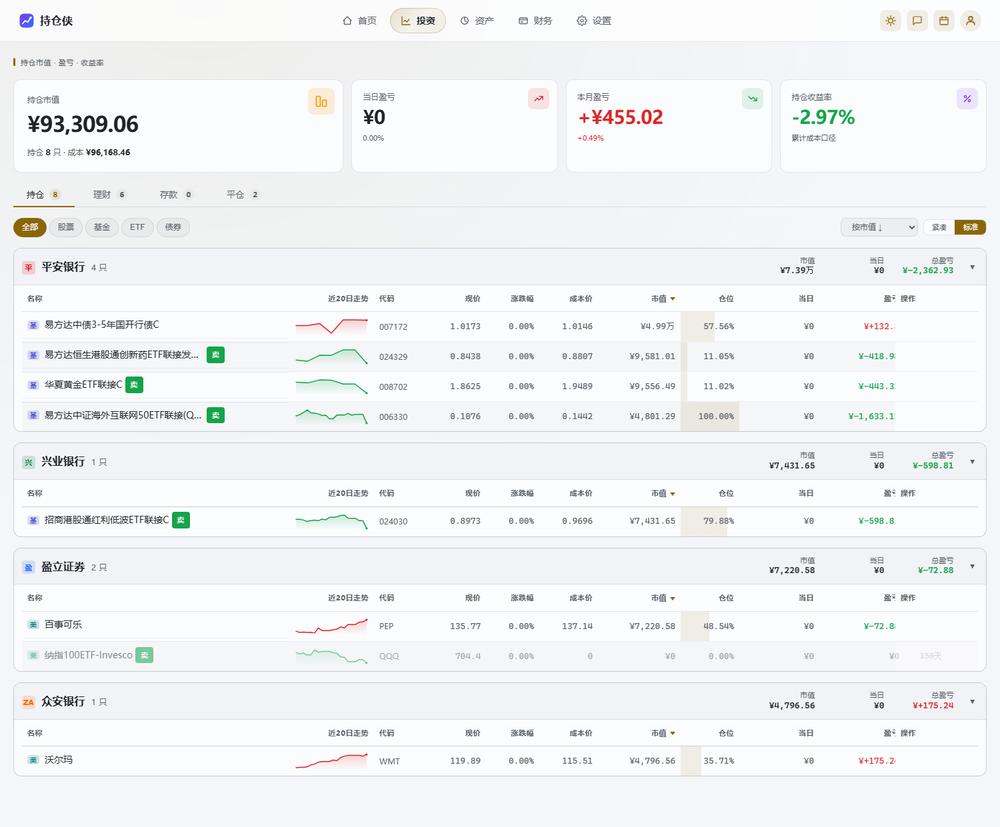
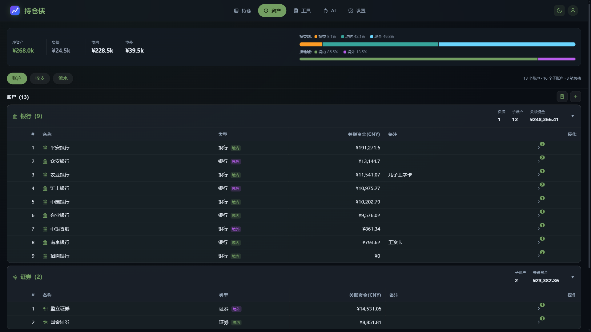
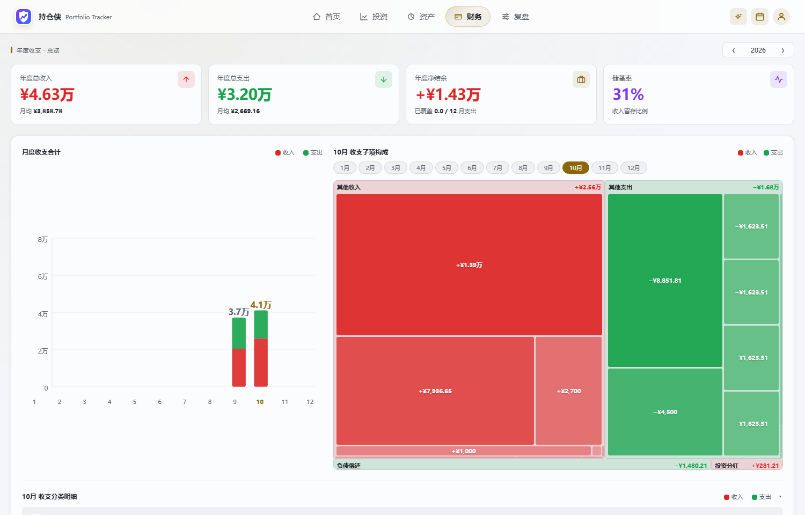
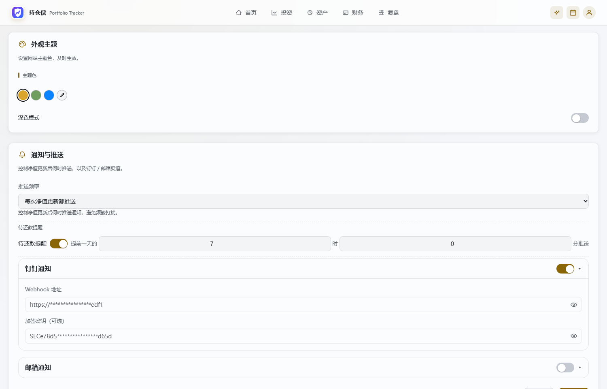
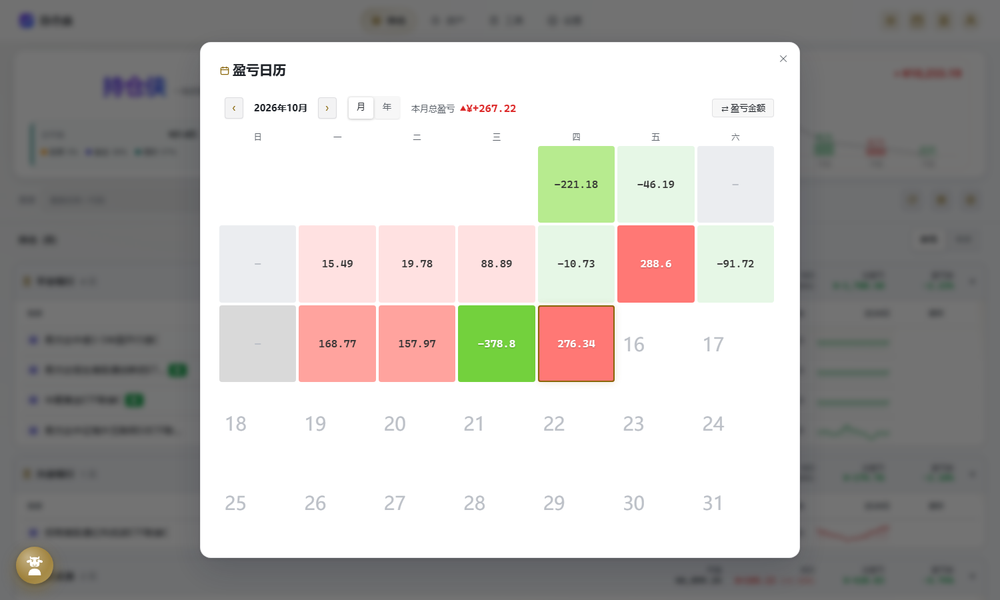
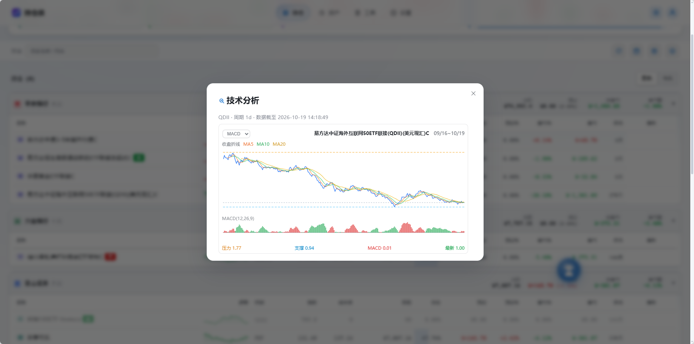
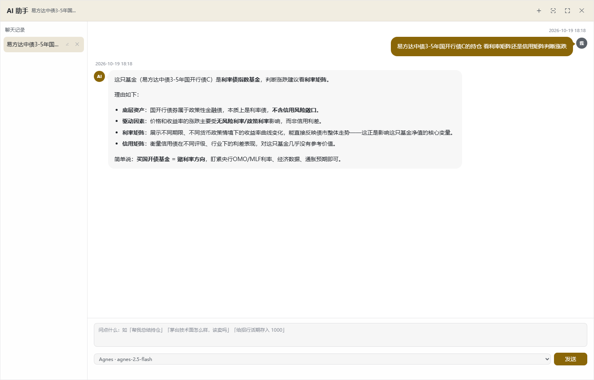

# 持仓侠 / Portfolio Tracker

自托管的多用户个人投资账本：统一管理 **A 股 / 美股 / 港股 / 基金（含理财）/ 现金 / 负债 / 收支**，行情自动刷新、盈亏自动计算与历史归档，并提供盈亏日历、技术分析与 AI 助手。桌面与移动端自适应，支持暗黑 / 亮色主题与自定义主题色。

> 在线 Demo：<https://www.mrchenyifei.icu:19999>（预置模拟数据，行情定时自动刷新）
> 品牌「持仓侠」，图标折线渐变紫；涨红跌绿（国内惯例）。

## 界面预览

| 预览 | 预览 |
| :---: | :---: |
| **首页 Dashboard**<br /> | **投资 · 持仓**<br /> |
| **资产全景**<br /> | **财务分析**<br /> |
| **设置**<br /> | **盈亏日历**<br /> |
| **技术分析**<br /> | **AI 助手**<br /> |

> 截图由 `node scripts/screenshot.mjs` 一键生成（Playwright + Edge，无需手动摆拍）。

## 功能一览

五大视图（顶部导航）：**首页 · 投资 · 资产 · 财务 · 再平衡**；设置收在右上角个人菜单里（同头像下拉）。

**首页 Dashboard** — 净资产 Hero + 资产分布 + 快捷功能 + 最新流水，一眼看全局。

**投资（持仓 / 理财 / 存款 / 平仓）**
- 持仓：A 股 / 美股 / 港股 / 基金按来源分组，展示当日盈亏、持仓收益率、持有天数与近 30 日走势；
- 加仓 / 减仓 / 现金分红（含红利再投）/ 交易回退（LIFO，原记录留痕）；清仓后可重开。
- 理财：净值快照对比、申赎流水、赎回 / 减仓 / 清仓；存款（定期 / 大额存单）到期确认后落账利息。
- 平仓：持仓（份额归零）+ 理财（归档）的落袋收益总览。
- 基金定投：计划（周期 / 金额 / 限购 / 暂停）+ 期次（逐期确认、可改可撤、禁删已执行）。

**资产全景** — 子视图：账户（来源 / 多币种现金子账户 / 负债，账户 ⇄ 负债可转换、子账户间转账）/ 流水 / 收支（一次性 / 循环计划，逐月还款可视化，待还款提前一天提醒）。

**财务** — 年度收支分析：4 张 KPI 卡 + 年度收支热力图 + 月度分类明细（语义分类：收入 / 支出 / 转账）。

**再平衡** — 按 **股票 / 基金 / 理财 / 现金** 四大类做「比例 + 收益」双维度追踪：
- 5 张 KPI 卡（组合总市值 / 目标年化收益 / 超额收益率 / 最大偏离 / 待调整金额）+ 一句话结论条（偏保守还是偏激进、一年差多少钱、主因是哪类）。
- 目标 vs 实际条形对比 + 预期年化收益双条（当前实心 / 目标虚线），表格按 目标 / 实际 / 偏离 / 年化 / 收益影响 / 建议 七列展开；四类「收益影响」相加恒等于组合超额收益金额。
- 目标权重与三类假设（权重 / 预期年化 / 波动率）在「目标与假设」弹框里配置，弹框内实时试算目标与当前的预期年化；可另设**年度收益率目标**，KPI 直接报「还差多少钱」。
- 偏离阈值（默认 1pp）决定哪些类别进「本次调整清单」；买卖金额天然配平（合计为 0）。历史快照落库当时的目标/实际权重与收益率，改假设不会回改历史。
- **日常开销不计入**：现金子账户可勾「日常开销账户」（资产页子账户行打「日常」徽标），这类钱既不算现金类市值也不进总市值分母 —— 生活费不是可配置资产，混进去会让系统建议你把下个月的开销转出去，同时把股票/基金的低配放大。剔除规模在表格下方明示。


**盈亏日历 & 技术分析**
- 盈亏日历：按日热力着色，年 / 月跳转，单日持仓级明细（含理财收益）。
- 技术分析：每只持仓 K 线 + MA / MACD / RSI / KDJ / BOLL，自动信号评级（看多 / 看空），结果按日缓存；场外基金 / QDII 可关联场内 ETF 代码复用其 K 线与信号。

**现金 & 负债** — 多币种（CNY / HKD / USD）现金子账户，出资 / 回款自动联动记账；负债清偿与待还款提醒。

**AI 助手** — 右下角悬浮聊天面板（多会话 + 工具调用式对话），可查账本、记流水、做技术分析、看资产再平衡偏离，支持一键生成全资产 / 权益类总结，可每日收盘后自动推送；Markdown 渲染并做 XSS 转义。

**MCP 服务** — 内建零依赖 MCP 服务端（stdio / HTTP），供 hermes 等 AI 客户端查询账本并按名称 / 代码定位实体记录流水（写 `record_transaction`；读 `list_*` 系列 + `get_rebalance` 再平衡快照）。工具实现由 Web 层注入，AI 答复与页面数字同源。默认关闭、零开销。

**多用户 & 主题** — 用户隔离（`X-User-Id`，上限 5 人、每类资产每用户 200 条），清空 / 删除需输入确认短语；暗黑 / 亮色双主题，主题色可自定义。

**手机采集客户端（pfclient）** — 配套 PySide6 桌面端（`client/`），把券商 / 基金 App 的持仓与理财页经 **USB 自动截图 + 本地 OCR** 采集并写回后端，覆盖 Windows / macOS；当前主力支持 iOS（USB DVT 原生截图 + CoreDevice 自动长屏），Android 通道规划中。

## 快速开始

镜像由 GitHub Actions 自动构建（`linux/amd64` + `linux/arm64`，推 GHCR，`latest` 随 main 更新）：

```bash
docker run -d --name portfolio -p 9989:9989 -p 9988:9988 \
  -v portfolio-data:/data \
  -e TZ=Asia/Shanghai \
  -e MCP_ENABLED=true -e MCP_TRANSPORT=http -e MCP_HTTP_ADDR=:9988 \
  ghcr.io/w1570187062/my-portfolio-hub:latest
# 或 docker compose up -d
```

- `9989`：Web 主端口；`9988`：MCP 端口（不需要 AI 客户端接入可省略，并将 `MCP_ENABLED` 留空）。
- 数据持久化于 `/data/portfolio.db`（挂载 volume）。访问 <http://localhost:9989>；升级只需 `docker pull` 后重建容器。

**从源码构建**（前端 `web/dist` 不入库，构建前必须先编译，否则 `Dockerfile` 因缺 `web/dist` 报错）：

```bash
npm --prefix web install && npm --prefix web run build   # 生成 web/dist（go:embed 内嵌）
docker compose build --no-cache && docker compose up -d --force-recreate
```

本地运行：`npm --prefix web run build && go build -o portfolio . && ./portfolio`（监听 `:9989`，可用 `PORT` 覆盖）。

## 技术栈

- 后端：Go + Gin + SQLite（`go:embed` 内嵌前端）；定时快照（美股 07:00 / A 股 15:15 / 基金 21:00）与每日 00:00 归零结算。
- 行情：A 股 / 港股 / 美股经腾讯行情源；基金经净值接口；PE/PB：A 股=东方财富，美 / 港=腾讯；汇率 CNY/HKD/USD 实时缓存。
- 前端：原生 HTML/CSS/JS（PWA，离线可用）。

## 许可

基于 **MIT License** 发布（详见 [LICENSE](LICENSE)）。自托管个人项目，请遵守所在司法辖区的金融数据法规。
