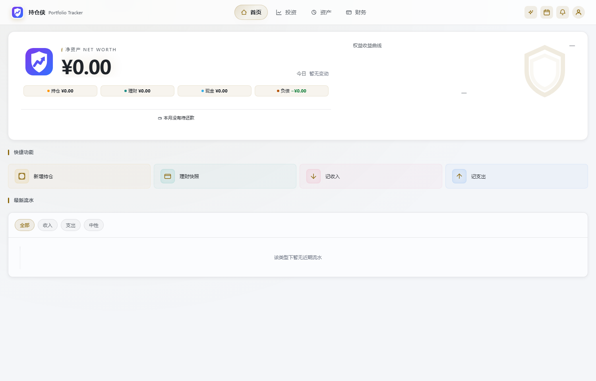

# 持仓侠 / Portfolio Tracker

自托管个人投资账本（多账本隔离）。统一管理 **A 股 / 美股 / 港股 / 基金（含理财）/ 现金 / 负债 / 收支**，行情自动刷新、盈亏自动计算与历史归档，并提供盈亏日历、技术分析、止盈止损提醒与 AI 助手。桌面与移动端自适应，支持暗黑 / 亮色主题与自定义主题色。

> 在线 Demo：<https://www.mrchenyifei.icu:19999>（只读演示，行情定时刷新）



## 功能一览

四大视图（主导航）：**首页 · 投资 · 资产 · 财务**；设置 / AI 助手 / 设备 / 通知在右上角个人菜单直达。

> 「复盘 · 收益率诊断」页已于 2026-11-03 整体下线（前端入口 / 页面 / JS / CSS 已移除，后端 `GET /api/review*` 接口未动）。

### 首页

净资产总览 + 资产分布 + 今日待办 + 最新流水，可切换 持仓 / 理财 / 存款 / 平仓 视角。

### 投资（持仓 / 理财 / 存款 / 平仓）

- **持仓** — A 股 / 美股 / 港股 / 基金按来源分组，展示当日盈亏、持仓收益率、持有天数与近 30 日走势；加仓 / 减仓 / 现金分红（含红利再投）/ 交易回退（LIFO 留痕）/ 清仓重开。
- **理财** — 净值快照对比、申赎流水、赎回 / 减仓 / 清仓。
- **存款** — 定期 / 大额存单，到期确认后落账利息。
- **平仓** — 持仓（份额归零）+ 理财（归档）的落袋收益总览。
- **定投计划** — 基金 / 股票标的挂计划（周期 / 金额 / 限购 / 暂停）+ 期次（逐期确认、可改可撤、禁删已执行）；每期费用直接填固定金额，不做费率换算。

### 资产（账户 / 现金 / 流水 / 收支）

- **账户** — 来源 / 多币种现金子账户 / 负债，账户 ⇄ 负债可转换、子账户间转账。
- **现金** — 多币种（CNY / HKD / USD）子账户，出资 / 回款自动联动记账。
- **流水** — 全量交易流水。
- **收支** — 一次性 / 循环计划，逐月还款可视化，待还款提前提醒。

### 财务

年度收支分析：4 张 KPI 卡 + 年度收支热力图 + 月度分类明细（收入 / 支出 / 转账语义分类）。

### 盈亏日历 & 技术分析

- **盈亏日历** — 按日热力着色，年 / 月跳转，单日持仓级明细（含理财收益）。
- **技术分析** — 每只持仓 K 线 + MA / MACD / RSI / KDJ / BOLL，自动信号评级，按日缓存；场外基金 / QDII 可关联场内 ETF 复用。

### 止盈止损提醒

每只持仓单独设方案（保守 / 均衡 / 激进 / 自定义 / 关闭），价位由收盘价与技术波动算出，无需手工盯盘。

- 触发后进右上角铃铛通知中心（红点未读），钉钉 / 邮件可单独开关。
- 同一档位只提醒一次。

### AI 助手

右下角悬浮聊天面板（多会话 + 工具调用），可查账本、记流水、做技术分析、看再平衡偏离，支持一键生成总结与每日收盘自动推送。

内置截图 OCR（tesseract.js，本地识别不上传），识别后一键记账。

### MCP 服务

内建零依赖 MCP 服务端（stdio / HTTP），供 AI 客户端查询账本并按名称 / 代码定位实体记录流水。默认关闭、零开销。配置项与工具列表见 [MCP 接口文档](docs/api/mcp.md)。

### 多账本 & 设备授权

- 账本数据隔离，上限 5 本、每类资产每账本 200 条。
- 首台设备自动成为主设备：加设备 / 改他机名 / 吊销他机 / 改 PIN / 删清账本 / 导入只归它（出码、吊销、删清、导入需再输 PIN）。
- 普通设备只能删除自己、给自己改名；已设置操作 PIN 时可把主设备切到任意设备（含本机），作为主设备报废时的自救通道。
- PIN 存哈希，认领时生成一次性恢复码；主设备退出登录 / 被吊销后自动交接身份。

### 手机采集客户端（pfclient）

配套 PySide6 桌面端（`client/`），券商 / 基金 App 持仓与理财页经 USB 自动截图 + 本地 OCR 采集写回后端，覆盖 Windows / macOS，当前主力支持 iOS，Android 规划中。

## 快速开始

镜像由 GitHub Actions 自动构建（`linux/amd64` + `linux/arm64`，推 GHCR，`latest` 随 main 更新）：

```bash
docker run -d --name portfolio -p 9989:9989 -p 9988:9988 \
  -v portfolio-data:/data \
  -e TZ=Asia/Shanghai \
  -e MCP_ENABLED=true -e MCP_TRANSPORT=http -e MCP_HTTP_ADDR=:9988 \
  ghcr.io/w1570187062/my-portfolio-hub:latest
# 或 docker compose up -d
```

- `9989`：Web 主端口；`9988`：MCP 端口（不需 AI 客户端接入可省略，并将 `MCP_ENABLED` 留空）。
- 数据持久化于 `/data/portfolio.db`。访问 <http://localhost:9989>；升级只需 `docker pull` 后重建容器。

**从源码构建**（前端 `web/dist` 不入库，构建前必须先编译，否则 `Dockerfile` 因缺 `web/dist` 报错）：

```bash
npm --prefix web install && npm --prefix web run build
docker compose build --no-cache && docker compose up -d --force-recreate
```

本地运行：`npm --prefix web run build && go build -o portfolio . && ./portfolio`（监听 `:9989`，可用 `PORT` 覆盖）。

## 技术栈

- 后端：Go + Gin + 纯 Go SQLite（`go:embed` 内嵌前端）；定时快照（美股 07:00 / A 股 15:15 / 基金 21:00）与每日 00:00 归零结算；快照后跑止盈止损扫描。
- 行情：A 股 / 港股 / 美股经腾讯行情源；基金经净值接口；PE/PB：A 股=东方财富，美 / 港=腾讯；汇率 CNY/HKD/USD 实时缓存。
- 前端：原生 HTML/CSS/JS（PWA，离线可用）。

## 许可

基于 **MIT License** 发布（详见 [LICENSE](LICENSE)）。自托管个人项目，请遵守所在司法辖区的金融数据法规。
