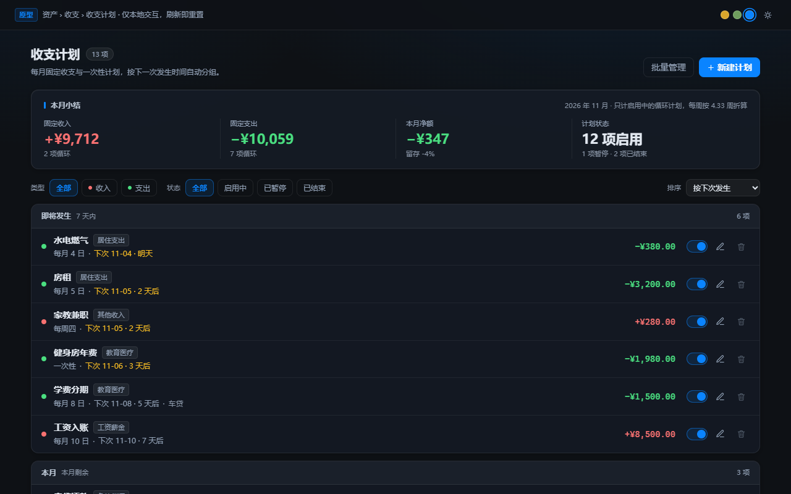
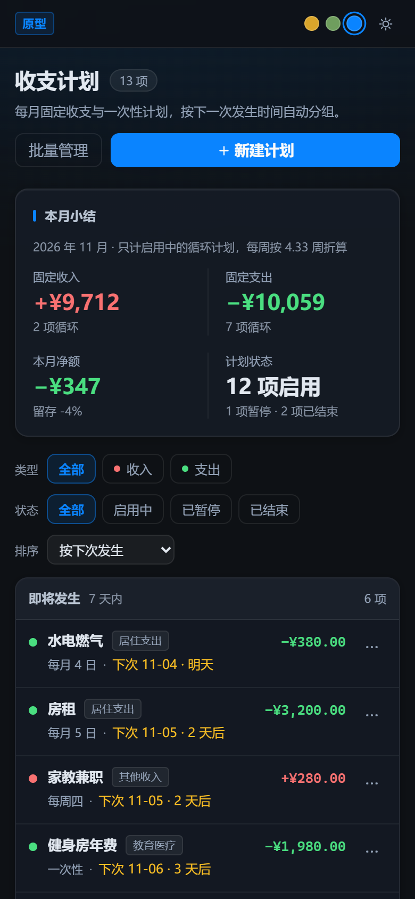

# 收支计划改版方案

> 状态：**第一期已落地**（2026-11-03，含软删除/撤销/行内编辑；不含「每周」）  
> 原型：[`tab-redesign-prototype/cashflow-plan-prototype.html`](../tab-redesign-prototype/cashflow-plan-prototype.html)  
> 原型截图：`docs/screenshots/cashflow-plan-desktop-1280x800.png`、`docs/screenshots/cashflow-plan-mobile-390x844.png`  
> 落地截图：`docs/screenshots/cashflow-plan-impl-desktop-1280x800.png`、`docs/screenshots/cashflow-plan-impl-mobile-390x844.png`

## 一句话结论

现状最要命的两个问题是**「没有删除入口」和「把未来日程做成了按月翻页的卡片」**；核心改法是**列表按“下次发生”分组 + 行内直接操作 + 删除走 5 秒软删除撤销**，新增/详情收进抽屉，批量与筛选补齐规模化能力。

---

## 1. 现状问题与证据

| # | 问题 | 证据 | 直接后果 |
|---|---|---|---|
| 1 | 表格和弹窗都没有删除按钮 | [index.html L1119-L1122](file:///c:/Users/chenyifei/WorkBuddy/portfolio/web/index.html#L1119-L1122) 的 `modal-actions` 只有“保存”和完成态插槽；[app.js L4740-L4745](file:///c:/Users/chenyifei/WorkBuddy/portfolio/web/app.js#L4740-L4745) 每张卡只有一个铅笔按钮 | 用户找不到删除，只能“改截止日期”绕过 |
| 2 | 所有编辑都进 460px 弹窗，字段平铺 | [index.html L1062-L1123](file:///c:/Users/chenyifei/WorkBuddy/portfolio/web/index.html#L1062-L1123) | 方向/模式/分类/金额/账户混在一屏，移动端更挤 |
| 3 | 打开弹窗前串行拉 5 组数据 | [app.js L11464-L11507](file:///c:/Users/chenyifei/WorkBuddy/portfolio/web/app.js#L11464-L11507)（`loadSourcesCache` → `loadCustomFlowCats` → `loadCashAccounts` → `loadLiabilitiesForCf`） | 每次点铅笔都有明显等待 |
| 4 | 每个计划是一张“单月卡”，带左右翻月箭头 | [app.js L4747-L4758](file:///c:/Users/chenyifei/WorkBuddy/portfolio/web/app.js#L4747-L4758) | 计划本质是未来日程，却被拆成“按月对账单”；多卡各自翻页，认知成本高 |
| 5 | 排序只按 `day_of_month`，一次性排最后 | [db.go L2825](file:///c:/Users/chenyifei/WorkBuddy/portfolio/internal/db/db.go#L2825) | 没有“下一次发生”概念，跨月顺序失真；无分组、无筛选、无批量 |
| 6 | 空态只有一行文字 | [app.js L4795](file:///c:/Users/chenyifei/WorkBuddy/portfolio/web/app.js#L4795) | 新用户不知道先建什么 |
| 7 | 数据表没有启用/暂停字段 | [db.go L1393-L1409](file:///c:/Users/chenyifei/WorkBuddy/portfolio/internal/db/db.go#L1393-L1409) 仅 `pattern / one_time_date / end_date` | 只能删除或改截止日，不能“先停一停、以后恢复” |
| 8 | 删除是硬删，并连带删除完成记录 | [cashflow.go L206-L217](file:///c:/Users/chenyifei/WorkBuddy/portfolio/internal/api/cashflow.go#L206-L217) + [db.go L2897-L2902](file:///c:/Users/chenyifei/WorkBuddy/portfolio/internal/db/db.go#L2897-L2902) | 无法撤销；历史完成态和“落袋”记录一起消失 |
| 9 | 不支持“每周”，且非 `one_time` 会被静默改成每月 | [cashflow.go L68-L75](file:///c:/Users/chenyifei/WorkBuddy/portfolio/internal/api/cashflow.go#L68-L75) 的 `default: p.Pattern = "recurring_fixed"`；前端也只给两个选项 [app.js L11449-L11458](file:///c:/Users/chenyifei/WorkBuddy/portfolio/web/app.js#L11449-L11458) | 周期表达能力缺失，未来加周计划必须先改后端归一化 |

**关于“缺删除”的准确结论**：后端 **已有** `DELETE /api/cashflow/plans/:id`（[handler.go L362](file:///c:/Users/chenyifei/WorkBuddy/portfolio/internal/api/handler.go#L362)、[cashflow.go L206](file:///c:/Users/chenyifei/WorkBuddy/portfolio/internal/api/cashflow.go#L206)）。所以这不是实现层缺失，而是**前端没有入口**；真正需要后端补的是**软删除 + 恢复**，否则 5 秒撤销只能靠“重建一条新 id 的计划”，完成历史会丢失。

另外，现有的本月合计其实已经算了（[app.js L7673-L7678](file:///c:/Users/chenyifei/WorkBuddy/portfolio/web/app.js#L7673-L7678)），但被推到页面顶部 KPI（[L7679-L7680](file:///c:/Users/chenyifei/WorkBuddy/portfolio/web/app.js#L7679-L7680)），和平铺在面板里的计划列表脱节，看一项要上下找。

---

## 2. 设计决策

| 决策 | 做法 | 理由（借鉴的机制） |
|---|---|---|
| D1 列表改成“日程” | 按下一次发生时间排序，分 **即将发生 / 本月 / 以后 / 已过期 / 已暂停** 五组 | YNAB、Monarch、Copilot 的 recurring 都按 next date 组织，用户关心“接下来要发生什么” |
| D2 行内先改三件事 | 金额点击即改、日期点击弹小浮层、开关直接暂停，全部就地生效 | 后台表格最佳实践：高频字段不弹窗，低频才进详情 |
| D3 新增/详情用右侧抽屉 | 方向做成分段控件置顶，字段分「基本信息 / 发生周期 / 关联」三组，底部固定保存 | 比整页跳转轻，比 460px 弹窗能容纳更多层级 |
| D4 删除 = 软删除 + 撤销 | 行内垃圾桶 / 详情底部删除；删除后 toast 5 秒“撤销”，不做确认弹窗 | Monarch/Things 类产品的 undo 模式；误删成本远低于每次确认的成本 |
| D5 批量化 | “批量管理”进入勾选态，类型/状态筛选 + 三种排序，批量删除后整组撤销 | 条数多时先筛后删，比逐条点更可靠 |
| D6 状态可暂停 | 启用/暂停开关；暂停项落到底部分组且不计入小结 | 现实里房租、会员都会“暂停一段时间”，删除不是唯一解 |

**明确不做的**：拖拽排序、自动记账、计划间的转账联动、多币种汇总重构。原型金额统一按人民币展示；落地时仍应复用现有 `cnyOf` 折算逻辑。

---

## 3. 交互流程

### 3.1 新增
1. 点右上「新建计划」→ 右侧抽屉（移动端为底部抽屉）。
2. 默认「收入」，先选方向（收入=红、支出=绿，沿用项目 `--up/--down` 语义）；分类选项随方向切换。
3. 周期三选一：每月（1–31 号，月末自动取当月最后一天）/ 一次性（必填日期）/ 每周（选星期）。
4. 可填截止日期、关联账户/负债、提醒开关。
5. 保存校验：名称必填、金额 > 0、一次性必须有日期；失败仅在抽屉内提示，不关闭抽屉。
6. 保存成功 → 抽屉关闭 → 新行落到对应分组 → toast 5 秒可撤销（撤销=删除该新建项）。

### 3.2 行内编辑
- **金额**：点数字变输入框，Enter/失焦保存，Esc 取消；≤0 拒绝并提示。保存后 toast 可撤销旧值。
- **日期**：点“下次 11-04 · 明天”弹浮层，浮层里可同时切周期（每月/一次性/每周）并改具体日期；保存后即时重排、重分组。
- **开关**：即时暂停/启用；暂停后行变淡、移到「已暂停」组、从小结中剔除；toast 可撤销。

### 3.3 详情编辑
- 点行主体或铅笔 → 同一个抽屉，标题变「编辑收支计划」，底部左侧出现「删除计划」。
- 抽屉内可改全部字段；保存后 toast 可撤销整次修改。

### 3.4 删除与撤销
1. 行内垃圾桶 / 详情删除 → 先从 UI 移除，再发 `DELETE`。
2. 成功后底部 toast：「已删除「房租」/ 已删除 3 个计划」+「撤销」+ 5 秒进度条。
3. 5 秒内点撤销 → 发恢复请求，行回到原位置。
4. 超时未撤销 → 软删除记录保留在库中（可后续做回收站/清理任务）。
5. 请求失败 → 行恢复显示 + 错误 toast；不出现“看着删了其实没删”的假象。

> 批量删除只发一次批量请求，撤销时整组恢复，避免逐条补偿只成功一半。

### 3.5 筛选 / 排序 / 批量
- 类型（全部/收入/支出）、状态（全部/启用中/已暂停/已结束）。
- 排序：按下次发生（默认）/ 按金额 / 按名称；分组不变，只影响组内顺序。
- 批量：进入勾选态 → 表头上方吸附条显示已选数 → 「删除所选」→ 一次 toast 撤销全部。
- 空态：无计划时引导“先建工资 + 房租”；筛选无结果时提供「清除筛选」。

---

## 4. 后端需要补的接口与字段

### 4.1 表结构（`cashflow_plans`）

| 字段 | 类型 / 默认 | 用途 |
|---|---|---|
| `enabled` | `INTEGER NOT NULL DEFAULT 1` | 启用/暂停开关；暂停不计入月度小结、不触发提醒 |
| `deleted_at` | `TEXT NOT NULL DEFAULT ''` | 软删除时间（`YYYY-MM-DD HH:MM:SS`）；列表过滤 `deleted_at=''` |
| `weekday` | `INTEGER NOT NULL DEFAULT 5` | 仅周计划使用，`0=周日…6=周六`（与 JS `getDay()` 对齐） |

- 需要索引：`(user_id, deleted_at)` 或至少在列表查询里加 `deleted_at=''`。
- `cashflow_plan_done` **不动**：软删除的目的就是保住完成历史与真实流水引用。
- 若第一期不做“每周”，`weekday` 可先不建；但 `pattern` 归一化必须保留扩展位，不能再把未知值静默改成每月。

### 4.2 接口契约

| 方法 / 路径 | 变更 | 契约 |
|---|---|---|
| `GET /api/cashflow/plans` | 改查询 | 只返回 `deleted_at=''`；响应 `plans[]` 增加 `enabled`、`weekday`。`next` 不需要后端算，前端按本地时区计算即可 |
| `PUT /api/cashflow/plans/:id` | 保留 | 抽屉整体保存继续用它；`enabled` 一并接收 |
| `PATCH /api/cashflow/plans/:id` | **新增** | 行内局部更新。请求体只带要改的字段：`{enabled?, amount?, pattern?, day_of_month?, one_time_date?, weekday?}`；返回 `{plan}`。服务端做与 PUT 相同的校验（金额>0、一次性有日期、月底钳制） |
| `DELETE /api/cashflow/plans/:id` | **语义改为软删除** | `UPDATE cashflow_plans SET deleted_at=now WHERE id=? AND user_id=?`；返回 `{ok:true}`。不再 `DELETE FROM`，不再级联删 done |
| `POST /api/cashflow/plans/restore` | **新增** | 请求 `{ids:[1,2]}`；恢复当前用户 `deleted_at<>''` 的行；返回 `{restored:2}`。撤销按钮调用它 |
| `POST /api/cashflow/plans/bulk-delete` | **新增（建议）** | 请求 `{ids:[…]}`；单事务软删除并返回实际删除 id；批量撤销复用 `restore` |

`PATCH` 与 `restore` 都只接受当前用户的行；`restore` 对已恢复/不存在的 id 幂等跳过。

### 4.3 每周计划（可选，但影响面最大）
- `pattern` 允许 `recurring_weekly`，`weekday` 0–6；`day_of_month` 忽略。
- 同步修改：创建/更新的归一化校验（[cashflow.go L70-L75](file:///c:/Users/chenyifei/WorkBuddy/portfolio/internal/api/cashflow.go#L70-L75)）、完成记账的归属月份、月度完成态视图、到期提醒任务。
- 如果第一期不准备动“完成态/提醒”，**建议原型里保留每周但实现时先隐藏该选项**；否则会出现“能建周计划、完成记账算错月”的半成品。

### 4.4 提醒任务
现有 `notify` 的扫描必须补两个过滤：`enabled=1 AND deleted_at=''`。否则暂停/已删除计划仍会推送。

---

## 5. 移动端差异

- ≤720px：列表变两行卡片（名称+分类+金额 / 周期+下次+状态），行内开关与铅笔收进右侧「⋯」菜单；菜单含编辑、暂停/启用、删除。
- 小结 2×2 排列；工具条换行，排序独占一行。
- 抽屉改为底部全宽 sheet（92vh，圆角顶），底部按钮等宽；删除在编辑态单独一行。
- 删除仍走 toast 撤销；批量条换行显示，避免挤压。
- 触屏无 hover：删除入口不能只靠 hover 显示。

---

## 6. 从原型到落地改动清单

| 文件 | 改动 | 规模 |
|---|---|---|
| `web/index.html` | 移除 `cashflowModal`（L1062-L1125），新增抽屉与全局 toast 容器；保留完成态按钮插槽的挂载点 | M（约 100 行替换） |
| `web/app.js` | 删除 `fpCardHTML / fpNav / fpActHTML / prefetchPlanMonths` 及翻月委托（约 L4738-L4827）；改为分组列表渲染、行内编辑、抽屉、toast 撤销、批量与筛选 | L（净增约 450–600 行） |
| `web/style.css` | 新增列表/分组/抽屉/浮层/toast/批量条样式，复用现有 token；删除 `.fp-*` 中仅翻月使用的规则 | M（约 300 行） |
| `internal/db/db.go` | 迁移 `enabled/deleted_at/weekday`；列表过滤软删；`DeleteCashflowPlan` 改软删；新增 `RestoreCashflowPlans` | S–M |
| `internal/api/cashflow.go` / `handler.go` | `PATCH`、`restore`、`bulk-delete` 路由与校验；提醒过滤；如做周计划再改归一化 | M |
| `docs/ui-design-spec.md` | 若要固化为规范，补一节“计划/日程类列表”的行内操作与 undo 约定 | S |

不含“每周”联动的完整改造量约 **3 个文件前后端 + 2 个接口**；做周计划需额外动完成态与提醒，工作量翻倍。

---

## 7. 原型自检结果

本地 `http.server` + Playwright（Edge，1280×800 与 390×844）实际点通：

- 新增 → 行内改金额 → 行内改日期 → 暂停/启用 → 删除 → 撤销 → 批量删 2 条 → 批量撤销。
- 类型/状态筛选、组内按金额排序、空态、明暗切换、移动端「⋯」菜单与底部抽屉。
- 控制台 **0 报错、0 pageerror**；桌面与移动端均无横向滚动。

---

## 8. 验收时要确认的 4 个取舍

1. **已过期**是否要留在列表（原型留，归「已过期」组）还是自动隐藏？
2. **暂停**是否要从本月小结剔除（原型剔除）；若希望“暂停也占预算”，需改口径。
3. **撤销窗口固定 5 秒**是否够用；延长到 10 秒只需改常量。
4. **每周计划**是否进第一期——它决定后端要不要现在动完成态与提醒。

---

## 9. 第一期落地记录（2026-11-03）

### 9.1 实际范围

- **不做每周**：`pattern` 仍只接受 `recurring_fixed` / `one_time`，原型里的「每周」选项未落地。
- 行内日期浮层只改当前周期对应的日期值（每月改 `day_of_month`，一次性改 `one_time_date`），**不切换周期**——PATCH 不支持改 `pattern`，避免出现“切了周期但完成态/提醒口径不对”的半成品。
- 新增/详情复用原 `#cashflowModal`，改为右侧抽屉（≤640px 变底部 sheet）；字段分组与提醒开关沿用原表单。

### 9.2 实际数据与接口

| 项 | 落地实现 |
|---|---|
| 表结构 | `cashflow_plans` 增 `enabled INTEGER NOT NULL DEFAULT 1`、`deleted_at TEXT NOT NULL DEFAULT ''`；沿用 `addColumnIfMissing` 幂等迁移，老数据自动带默认值 |
| 删除 | `DELETE /api/cashflow/plans/:id` → `UPDATE ... SET deleted_at=?`，**不再级联删除 `cashflow_plan_done`**，撤销后完成历史仍在 |
| 新增接口 | `PATCH /api/cashflow/plans/:id`（amount / day_of_month / title / type / enabled / one_time_date）、`POST /api/cashflow/plans/bulk-delete`、`POST /api/cashflow/plans/restore`（单条/批量都走 ids） |
| 读取过滤 | 统一收口在 `db.ListCashflowPlans`：`COALESCE(deleted_at,'')=''`；列表、资产页汇总、首页待办、today、提醒、账户引用校验全部受益 |
| 暂停 | `today` 与 `notify` 显式跳过 `enabled=0`；前端小结只统计启用中的计划 |
| 归属校验 | PATCH / complete / uncomplete 均拒绝已软删计划；PATCH 改 `type` 时若已关联负债返回 400 |

### 9.3 验证结果

- `node --check web/app.js`、`go build ./...`、`web/build.mjs`（死代码 0）、`web/check-ui.mjs`（17/17）全过。
- 本地 `AUTH_MODE=off` + Playwright（Edge）实测：新增 → 行内改金额/日期/名称 → 暂停 → 暂停撤销 → 删除即时移除 → 删除撤销 → 批量删除 → 批量撤销 → 刷新后软删计划不回来。
- 软删后 SQL 校验：`cashflow_plans` 行 `deleted_at` 有值，`cashflow_plan_done` 对应完成记录仍在。
- 已删计划 `PATCH` 返回 404；`/api/today/brief` 不含已删计划；暂停的到期计划从 `today` 消失。

### 9.4 回滚方式

> 迁移只加列、不改旧列，回滚分「代码」与「数据」两步，按需选择。

1. **代码回滚**：`git revert` 对应三次提交后重新 `bash scripts/deploy.sh`。旧代码不读 `deleted_at`，会把软删行重新显示出来——这是可接受的“回滚即复活”，但**不要**在线上已有大量软删数据时直接回滚到更老版本。
2. **数据回滚**：部署前已备份线上库（见部署记录）。如需彻底回到改版前，停容器 → 用备份覆盖数据文件 → 起容器。注意这会丢掉改版后新产生的计划与流水。
3. 只想清理软删残留：确认后 `DELETE FROM cashflow_plans WHERE deleted_at<>''`（会连带失去这些计划的撤销能力，但不会动 `cashflow_plan_done`）。
